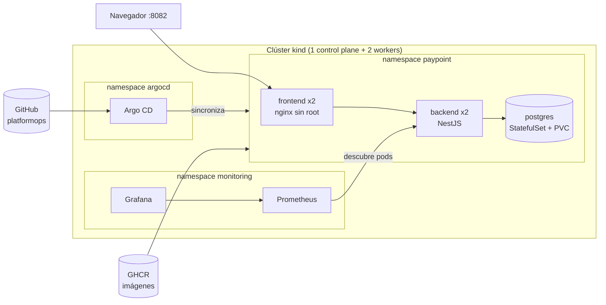
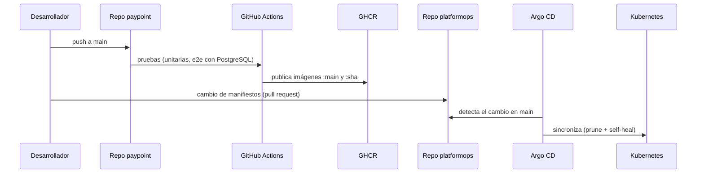

# PlatformOps

[](https://github.com/vzuliani97/platformops/actions/workflows/ci.yml)

Plataforma para desplegar y operar [PayPoint](https://github.com/vzuliani97/paypoint) en Kubernetes: manifiestos con Kustomize, GitOps con Argo CD, métricas y alertas con Prometheus y Grafana, e infraestructura en AWS (VPC, EKS, RDS, ECR) definida en Terraform. Todo corre localmente sin costo sobre un clúster kind de 3 nodos.

*English: Kubernetes delivery platform for the PayPoint app. Kustomize overlays, Argo CD GitOps, Prometheus + Grafana with alert rules, hardened workloads (non-root, read-only filesystems, NetworkPolicies, Pod Security Admission, PDB, topology spread), and Terraform for AWS (VPC, EKS, RDS, ECR) validated in CI. Runs locally at zero cost on a 3-node kind cluster.*

## Arquitectura



### Flujo de entrega (GitOps)



Nadie aplica cambios al clúster con `kubectl`: git es la fuente de verdad. Si alguien edita un recurso a mano, Argo CD lo revierte (`selfHeal`).

## Inicio rápido

Requisitos: Docker, kubectl y el repo `paypoint` clonado al lado de este. `make tools` descarga `kind` y `kubeconform` en `./bin`, con verificación SHA-256 y sin instalar nada en el sistema.

```bash
make up          # clúster + imágenes de PayPoint + despliegue + Prometheus/Grafana + prueba de humo
```

| Servicio | URL |
|---|---|
| PayPoint | http://localhost:8082 (`cajero@paypoint.local` / `paypoint-demo`) |
| Grafana | http://localhost:3030 (dashboard "PayPoint overview", acceso de solo lectura) |
| Prometheus | http://localhost:9090 (targets y alertas) |

Otros comandos: `make status`, `make smoke`, `make validate`, `make tf-validate`, `make down`.

**Modo GitOps:** `make gitops` instala Argo CD, crea el Secret fuera de git y registra las Applications de `argocd/`. Desde ese momento, Argo CD despliega `k8s/overlays/gitops` (imágenes de GHCR) desde la rama `main`. `make argocd-ui` y `make argocd-password` dan acceso a la consola.

## Estructura

| Ruta | Contenido |
|---|---|
| `kind/cluster.yaml` | Clúster local de 3 nodos y puertos expuestos |
| `k8s/base/` | PostgreSQL, backend, frontend y NetworkPolicies |
| `k8s/overlays/local/` | Imágenes cargadas en kind y Secret generado desde `secrets.env` (no versionado) |
| `k8s/overlays/gitops/` | Imágenes de GHCR, lo que despliega Argo CD |
| `observability/` | Prometheus (descubrimiento de pods y alertas) y Grafana (datasource y dashboard provisionados) |
| `argocd/` | Applications de Argo CD |
| `terraform/aws/` | VPC, EKS, RDS y ECR |
| `scripts/` | Instalación de herramientas y prueba de humo |

## Decisiones de diseño

**Disponibilidad**
- 2 réplicas del backend y del frontend. `topologySpreadConstraints` reparte los pods en nodos distintos, y un `PodDisruptionBudget` mantiene al menos uno disponible durante mantenimientos.
- Rolling update con `maxUnavailable: 0`: un despliegue nunca baja la capacidad.
- `startupProbe`, `readinessProbe` y `livenessProbe` separadas: las migraciones al arrancar no hacen que Kubernetes reinicie el pod.
- Las migraciones corren al iniciar cada réplica, protegidas por un *advisory lock* de PostgreSQL, así que solo una las aplica.

**Seguridad**
- Contenedores sin root, sistema de archivos de solo lectura, sin escalamiento de privilegios, `capabilities: drop ALL` y seccomp `RuntimeDefault`.
- Pod Security Admission en los namespaces: `baseline` obligatorio en `paypoint` y `restricted` en `monitoring`.
- NetworkPolicies con denegación por defecto: PostgreSQL solo acepta conexiones del backend, y el backend solo del frontend y de Prometheus.
- Secretos fuera de git: el overlay local los genera desde un archivo ignorado, y en GitOps se crean aparte.
- `/metrics` no se expone hacia afuera, porque Nginx solo enruta `/api` y `/health`.
- Prometheus usa una ServiceAccount con permiso de solo lectura sobre pods y nada más.

**Observabilidad**
- Prometheus descubre los pods anotados con `prometheus.io/scrape` y recoge métricas de cada réplica por separado, no a través del Service, para que un pod con problemas no quede oculto.
- 4 alertas: backend caído, más de 5% de errores 5xx, p95 mayor a 1 s y ventas quedando en `PENDING` (el proveedor de recargas no responde).
- Grafana con datasource y dashboard provisionados como código: tráfico, latencia p95, errores, ventas por estado y canal, y memoria por pod.

## Verificado

Probado en el clúster local:

| Prueba | Resultado |
|---|---|
| Esquemas de los 39 manifiestos renderizados (`make validate`) | 0 errores |
| Prueba de humo: web, health, login, venta confirmada, métricas | OK |
| Venta firmada con HMAC de un integrador, pasando por Nginx | 201 |
| Prometheus recoge las 2 réplicas, cada una en un nodo distinto | 2/2 `up` |
| Un pod sin la etiqueta `app=backend` intenta conectarse a PostgreSQL | `no response` (bloqueado) |
| Un pod con la etiqueta `app=backend` | `accepting connections` |
| Argo CD v3.5.6 instalado; Applications validadas contra la API del clúster | OK |
| `terraform validate` y `fmt -check` | OK |

## AWS con Terraform

`terraform/aws` define el equivalente productivo:

- **VPC** en 3 zonas: subredes privadas para los nodos, públicas para balanceadores y aisladas para la base de datos.
- **EKS** (módulo oficial `terraform-aws-modules/eks` v21) con nodos *spot* en desarrollo y *on-demand* en producción, add-ons gestionados y el endpoint de la API restringido a IPs permitidas (la validación rechaza `0.0.0.0/0`).
- **RDS PostgreSQL 16** privado, cifrado, con backups y la contraseña generada por AWS en **Secrets Manager** (nunca en el código ni en el estado). Solo los nodos de EKS pueden conectarse.
- **ECR** con tags inmutables, escaneo de vulnerabilidades al subir y una política de retención.
- `environment = "production"` activa Multi-AZ, protección contra borrado, snapshot final y un NAT por zona.

**Nunca se ha aplicado** (`terraform apply`), porque genera costos. Costo aproximado del entorno demo en us-east-1, con precios de referencia que hay que confirmar en la calculadora de AWS: plano de control EKS ~USD 73/mes, NAT Gateway ~USD 33/mes más tráfico, 2 nodos t3.medium spot ~USD 20/mes, RDS db.t4g.micro ~USD 15/mes. **Total: unos USD 140/mes.** El CI solo ejecuta `fmt` y `validate`.

```bash
cd terraform/aws
cp terraform.tfvars.example terraform.tfvars   # tu IP en admin_cidrs
terraform init && terraform plan                # requiere credenciales de AWS
```

## Siguientes pasos

- Secretos con **External Secrets Operator** leyendo AWS Secrets Manager, o con **Sealed Secrets**.
- **Argo CD Image Updater** o un commit automático que fije el tag por SHA, en vez de usar el tag móvil `main`.
- Ingress con **Gateway API** y TLS (cert-manager).
- **HPA** con metrics-server, **Alertmanager** para notificar, y **Loki** para logs.
- Escaneo de IaC (Checkov o tfsec) y de imágenes (Trivy) en el CI, y autenticación del CI con AWS por **OIDC**, sin llaves de larga duración.
