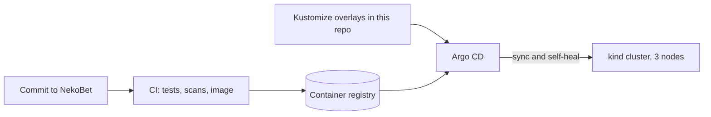
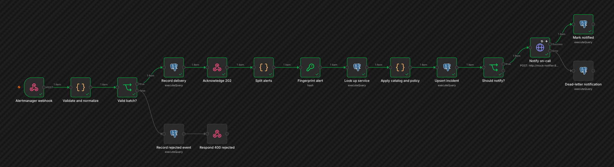
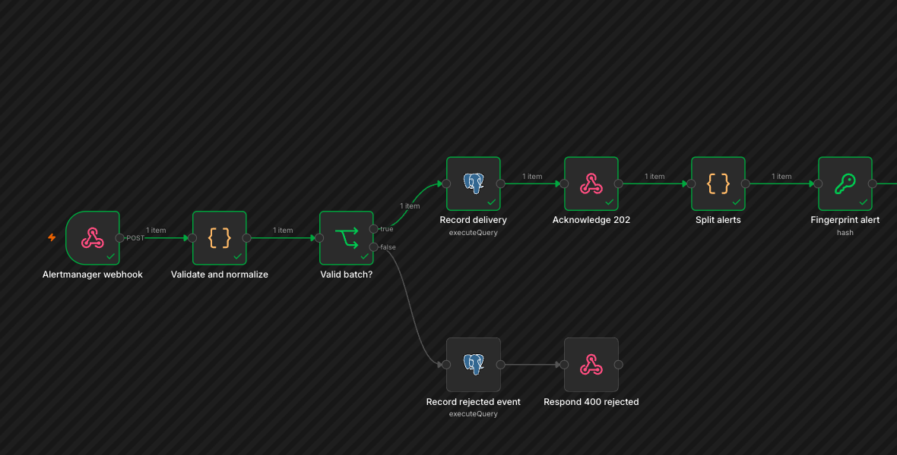
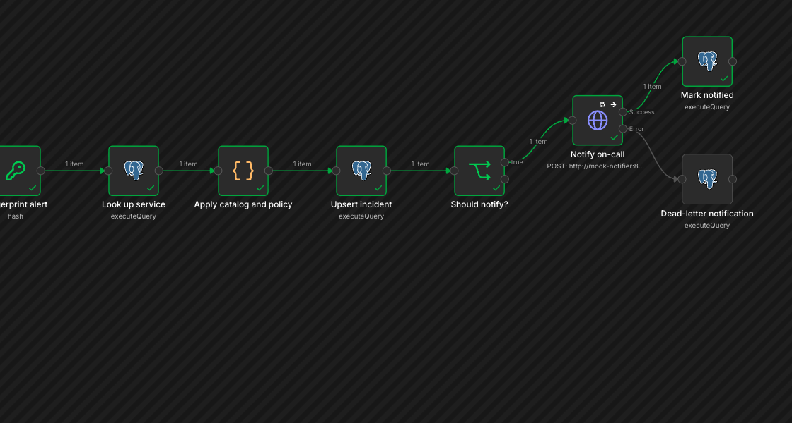
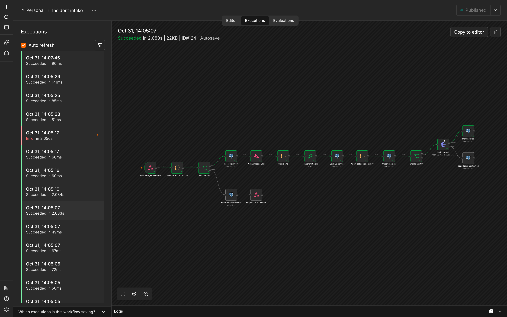
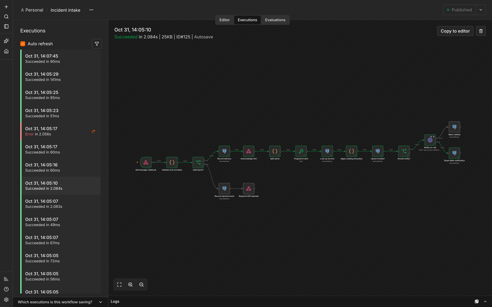
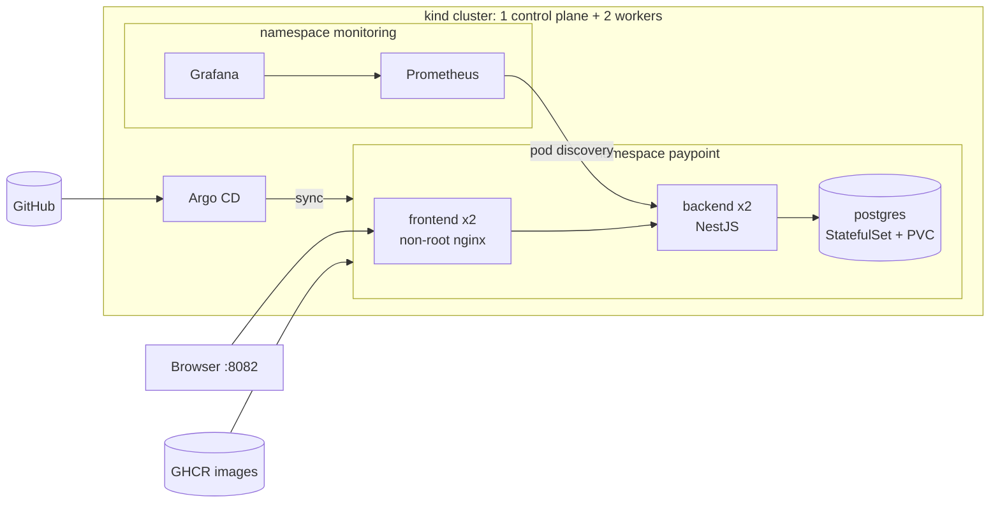

# OpsCircuit — Cloud Delivery & Incident Automation Lab

*Formerly PlatformOps.*

[](https://github.com/vzuliani97/opscircuit/actions/workflows/ci.yml)

A local-first platform engineering and incident-operations lab. It delivers and operates [NekoBet](https://github.com/vzuliani97/nekobet), whose code, images and namespace keep its original name, `paypoint`: Kubernetes manifests with Kustomize, GitOps with Argo CD, Prometheus and Grafana with alerts, hardened workloads, game-day drills with a postmortem, and the AWS production equivalent in Terraform. Everything runs locally at zero cost on a 3-node kind cluster.

**Problem:** applications go down, get misconfigured or receive broken releases. The team has to notice fast, protect users, and recover with one command.

## What it is for

A small team ships a transactional service to Kubernetes and has to keep it up. This lab shows the whole loop: deliver with GitOps, watch it with metrics and alerts, turn a storm of alert deliveries into one incident and one page, and prove the recovery with drills.

## What I built

Everything in this repository:

- **Platform:** a 3-node kind cluster, Kustomize overlays, Argo CD applications (GitOps), and Prometheus, alert rules and Grafana dashboards provisioned as code.
- **Hardening:** non-root workloads, NetworkPolicies, Pod Security Admission, resource limits; Checkov with zero failed checks and documented exceptions.
- **Supply chain and admission control:** Kyverno 1.19 with the CEL policy types. Pods must be hardened (restricted profile, read-only root), have requests, a memory limit and probes, and use an explicit tag; only images signed by NekoBet's CI on `main` may run, pinned to the verified digest. Each policy has CLI tests in CI.
- **Drills:** a total outage, a broken release and an unsigned image, a postmortem, and the fix for an alert that could never fire (`absent()`).
- **Incident automation (`ops-automation/`):** Alertmanager → self-hosted n8n → PostgreSQL → mock notifier, with an authenticated webhook, validation, the delivery stored before the 202, one incident per firing episode, enrichment with owner and runbook, bounded retries, dead letters and replay; 15 integration tests in CI.
- **Cloud design:** Terraform for AWS (VPC, EKS, RDS, ECR), validated in CI and never applied, because applying it would cost money.


## Stack

| Layer | Technologies |
|---|---|
| Containers and orchestration | Docker, Kubernetes on kind (1 control plane + 2 workers), Kustomize overlays |
| GitOps and CI/CD | Argo CD 3.5 (sync and self-heal), GitHub Actions (actions pinned by SHA) |
| Observability | Prometheus 3, Grafana 13 (dashboards as code), Alertmanager 0.34 |
| Incident automation | n8n 2.43 (self-hosted), PostgreSQL 18, Node.js test runner: 15 integration tests |
| Infrastructure as code | Terraform with the AWS provider 6 (VPC, EKS, RDS, ECR), validated in CI, never applied |
| Security and policy | Kyverno 1.19 (`ValidatingPolicy`, `ImageValidatingPolicy`), cosign keyless signature verification, Checkov 3.4, kubeconform, NetworkPolicies, Pod Security Admission, non-root workloads, ShellCheck |

## Processes, step by step

### 1. Deliver with GitOps



The NekoBet CI publishes images; Argo CD keeps the cluster equal to the overlays in Git. Deleting a Deployment by hand is undone by self-heal in about 2 seconds.

### 2. Observe

Prometheus scrapes both backend replicas and evaluates the alert rules, including an `absent()` rule for total outages; Grafana dashboards are provisioned as code.


### 3. Turn alerts into one incident (n8n)



| Validate, store, deduplicate | Enrich, decide, page |
|---|---|
|  |  |

1. **Alertmanager webhook:** a bearer token is required.
2. **Validate and normalize:** a malformed batch is stored as a rejected event and answered with `400`.
3. **Record delivery, then acknowledge `202`:** the delivery is saved before answering, so nothing is lost if a later step fails.
4. **Split and fingerprint:** each alert gets a SHA-256 of alert name, namespace, service and `startsAt`, one per firing episode.
5. **Look up service and apply catalog and policy:** owner, runbook and severity come from the service catalog.
6. **Upsert incident:** `INSERT … ON CONFLICT` in PostgreSQL, so 5 concurrent deliveries of one alert create one incident.
7. **Should notify? Notify on-call:** only a new incident, or one whose page failed before, is paged. Success marks it notified; a failure becomes a dead letter.

### 4. When something fails

Notifications are retried a bounded number of times. An execution that fails anyway reaches the error workflow, which records a dead letter, and `make replay` processes dead letters again.

| Retry | Dead letter | Lock timeout |
|---|---|---|
|  |  |  |

### 5. Practice the bad day

The outage drill removed every backend pod and showed that the "backend down" alert could never fire (no pods, no `up` series); an `absent()` rule fixed it. The bad-release drill was contained and rolled back. Both are in the [postmortem](docs/incidents/2026-10-30-postmortem.md).

## What is verified (on the local cluster)

| Check | Result | Evidence |
|---|---|---|
| End-to-end smoke test: web, health, login, a confirmed sale, metrics | Pass | `make smoke` |
| Signed partner sale through nginx inside the cluster | 201 | `scripts/` + NekoBet partner client |
| Prometheus scrapes both backend replicas, on different nodes | 2/2 up | `docs/screenshots/prometheus-targets.png` |
| NetworkPolicy: an unlabeled pod tries to reach PostgreSQL | `no response` (blocked) | Negative and positive probe |
| Game day: total backend outage | Found an alert that could never fire; fixed and re-verified | [Postmortem](docs/incidents/2026-10-30-postmortem.md) |
| Game day: broken release | Health 200 throughout; rollout stalled; rollback in one command | `docs/incidents/drill-bad-deploy.log` |
| Checkov on Terraform + rendered manifests | 0 failed checks (33 Terraform, 438 Kubernetes), with accepted findings documented. A clean static scan is not proof of no risk | `.checkov.yaml` |
| Schema validation of every rendered manifest | 39/39 valid | `make validate` |
| Kyverno policies on every rendered manifest, and policy tests (each policy rejects its bad fixture; the signature test runs against GHCR and Sigstore) | 24 checks, 0 failures; 29/29 tests | `make validate` |
| **Admission: bad workloads** (root, no limits or probes, `latest`, untagged) | Each one denied with its message; the real workloads restarted under the policies and the smoke test passes | `make policies`, server dry run |
| **Admission: unsigned image** (the same backend, built before signing) | Denied; the signed `main` admitted and pinned to its verified digest | [`drill-unsigned-image.log`](docs/incidents/drill-unsigned-image.log) |
| `terraform validate` and `fmt` | Pass | `make tf-validate` |
| **GitOps from GitHub**: Argo CD syncs `main`, pulls multi-arch images from GHCR | Synced/Healthy; smoke test passes | Revision on the cluster equals `main` |
| **Self-heal**: Deployment deleted by hand | Recreated by Argo CD in 2 s | Drill 2026-10-30 |
| CI on GitHub (validate, Kyverno policy tests, Terraform, Checkov, Gitleaks, shellcheck) | Green | Actions tab |
| **n8n incident automation lab**: authenticated Alertmanager webhook, validation, deduplication, enrichment, bounded retry, dead letters, replay, restart | 15/15 integration tests, locally and in CI | [Verification](docs/INCIDENT_AUTOMATION_VERIFICATION.md) |
| **Terraform applied on AWS** | **Never applied** (it would cost money) | — |

## Architecture



## Incident automation (n8n)

[`ops-automation/`](ops-automation) adds a self-hosted n8n workflow between Alertmanager and on-call.
- **Alertmanager** groups alerts.
- **n8n:**
  - authenticates and validates each delivery;
  - stores it before answering 202;
  - keeps one incident per firing episode;
  - adds owner and runbook from a catalog in git;
  - pages through a retrying notifier and dead-letters what still fails, for a safe replay.

It runs in Docker Compose with a mock notifier, and its 15 integration tests run in CI. Read more in the [architecture](docs/INCIDENT_AUTOMATION_ARCHITECTURE.md), [runbook](docs/INCIDENT_AUTOMATION_RUNBOOK.md) and [verification](docs/INCIDENT_AUTOMATION_VERIFICATION.md).


GitOps flow: a push to NekoBet runs its tests and publishes images to GHCR; Argo CD keeps the cluster in sync with `k8s/overlays/gitops` on `main` (`prune` + `selfHeal`). Nobody applies changes with `kubectl` in GitOps mode.

## Quick start

Requirements: Docker, kubectl, and the `nekobet` repo cloned next to this one (`PAYPOINT_DIR` in the Makefile). `make tools` downloads pinned `kind`, `kubeconform` and the Kyverno CLI into `./bin` and verifies their SHA-256; nothing is installed system-wide.

```bash
make up              # cluster + NekoBet + Prometheus/Grafana + smoke test (~5 min)
make drill-outage    # game day: total outage
make drill-bad-deploy
make policies        # Kyverno admission control with the policies in policies/
make drill-unsigned-image
make down
```

| Service | URL |
|---|---|
| NekoBet | http://localhost:8082 |
| Grafana (read-only anonymous) | http://localhost:3030 |
| Prometheus | http://localhost:9090 |

## Reliability

- 2 replicas spread across nodes (`topologySpreadConstraints`), a `PodDisruptionBudget`, and rolling updates with `maxUnavailable: 0`.
- Separate startup, readiness and liveness probes, so startup migrations never trigger restarts.
- Migrations run at startup under a PostgreSQL advisory lock, so only one replica applies them.
- **Alerts:** backend absent (total outage), backend down, more than 5% 5xx, p95 above 1 s, and sales stuck `PENDING` (provider not answering).

## Security

- Every workload runs as non-root, with read-only root filesystems, no privilege escalation, all capabilities dropped and seccomp `RuntimeDefault`. PostgreSQL runs as uid 70 with its writable paths on `emptyDir`.
- Pod Security Admission: `baseline` enforced in `paypoint`, `restricted` enforced in `monitoring`.
- Default-deny NetworkPolicies: PostgreSQL accepts only the backend; the backend accepts only the frontend and Prometheus. Verified with a blocked probe and an allowed one.
- Third-party images are pinned by digest. Secrets stay out of git: the local overlay generates them from an ignored file, and GitOps creates them out of band.
- Prometheus has a read-only ClusterRole on pods only.
- kind publishes its NodePorts on `127.0.0.1` only, so the app, Grafana and Prometheus are not reachable from the local network. `make validate` fails if a port mapping would listen on every interface.
- Kyverno admission policies ([`policies/`](policies/)), written in the CEL policy types that replace `ClusterPolicy` (deprecated in Kyverno 1.19): restricted pods with a read-only root filesystem; CPU and memory requests, a memory limit and probes; an explicit image tag; and a cosign keyless signature from NekoBet's CI on `main`. The signature policy checks pods, not Deployments, so Argo CD does not see the digest it pins as drift.
- CI: Checkov, Gitleaks over the full history, kubeconform, Kyverno policy tests, `terraform validate`, shellcheck, SHA-pinned actions and a least-privilege token.

## Terraform (AWS production equivalent, never applied)

- VPC across 3 explicit AZs with private, public and isolated database subnets.
- EKS (official module v21): spot nodes in dev, on-demand in production, and the API endpoint restricted to allowed CIDRs (`0.0.0.0/0` is rejected by validation).
- RDS PostgreSQL 16: private, encrypted, **TLS enforced**, IAM authentication, password generated into Secrets Manager, slow-query and DDL logging, Performance Insights, backups.
- ECR: immutable tags, scan on push, KMS encryption, lifecycle policy.
- `environment = "production"` turns on Multi-AZ, deletion protection, a final snapshot and one NAT per AZ.

Estimated cost of the demo environment in us-east-1: about **USD 140/month** (EKS control plane about 73, NAT about 33, 2 spot t3.medium about 20, RDS about 15). These are reference prices; check them with the AWS calculator.

## Known limitations and next steps

- The cluster's Prometheus does not route to Alertmanager yet. The n8n incident lab runs in Docker Compose next to the cluster; wiring the two together is the next step, together with a blackbox check of the public URL (open action items in the postmortem).
- The app images use the moving `main` tag in GitOps. Kyverno pins each pod to the verified digest, but git still does not record which build runs. Next: Argo CD Image Updater, or a commit that pins the SHA.
- Secrets are not managed by External Secrets or Sealed Secrets yet.
- No Ingress or Gateway API with TLS, no HPA, no centralized logs (Loki).

## Design walkthrough

[DESIGN_WALKTHROUGH.md](DESIGN_WALKTHROUGH.md): a 90-second demo script and the hard questions this design invites, with answers that point to code and evidence.

## License and provenance

MIT.

Independent portfolio reconstruction based on engineering patterns from professional work. It uses synthetic data and contains no employer code or confidential information.

## Portfolio

One of four connected projects at [vzuliani97.github.io](https://vzuliani97.github.io). The others: [Yamesi Core](https://github.com/vzuliani97/yamesi) (business operations, online at [yamesi.netlify.app](https://yamesi.netlify.app)), [NekoBet](https://github.com/vzuliani97/nekobet) (transactions and real time, online at [nekobet.netlify.app](https://nekobet.netlify.app)), [Applied Cyber Security](https://github.com/vzuliani97/applied-cybersecurity) (security assessment of NekoBet, Yamesi and OpsCircuit). Case study: https://vzuliani97.github.io/work/opscircuit/
