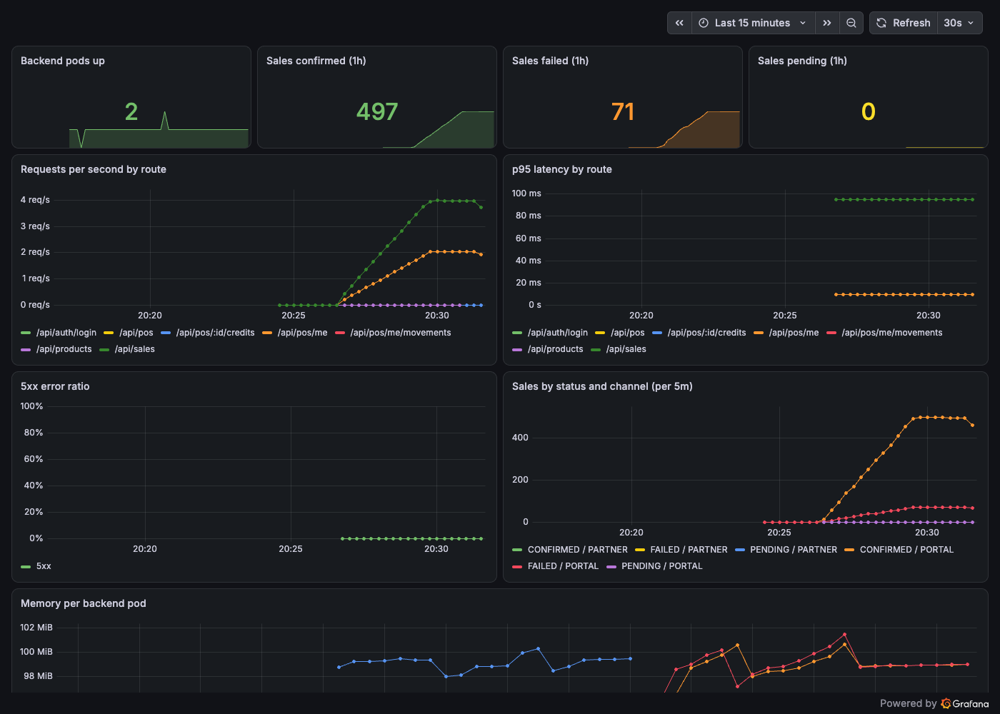
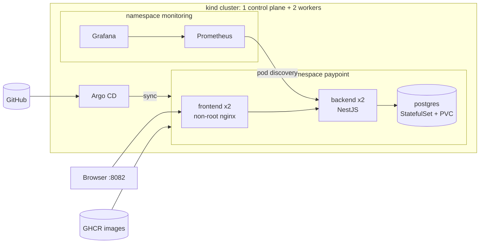

# PlatformOps

[](https://github.com/vzuliani97/platformops/actions/workflows/ci.yml)

Delivery and operations platform for [PayPoint](https://github.com/vzuliani97/paypoint): Kubernetes manifests with Kustomize, GitOps with Argo CD, Prometheus and Grafana with alerts, hardened workloads, game-day drills with a postmortem, and the AWS production equivalent in Terraform. Everything runs locally at zero cost on a 3-node kind cluster.

**Problem:** applications go down, get misconfigured or receive broken releases. The team has to notice fast, protect users, and recover with one command.



## What is verified (on the local cluster)

| Check | Result | Evidence |
|---|---|---|
| End-to-end smoke test: web, health, login, a confirmed sale, metrics | Pass | `make smoke` |
| Signed partner sale through nginx inside the cluster | 201 | `scripts/` + PayPoint partner client |
| Prometheus scrapes both backend replicas, on different nodes | 2/2 up | `docs/screenshots/prometheus-targets.png` |
| NetworkPolicy: an unlabeled pod tries to reach PostgreSQL | `no response` (blocked) | Negative and positive probe |
| Game day: total backend outage | Found an alert that could never fire; fixed and re-verified | [Postmortem](docs/incidents/2026-10-30-postmortem.md) |
| Game day: broken release | Health 200 throughout; rollout stalled; rollback in one command | `docs/incidents/drill-bad-deploy.log` |
| Checkov on Terraform + rendered manifests | 0 failures (33 TF checks, 438 K8s checks; accepted findings documented) | `.checkov.yaml` |
| Schema validation of every rendered manifest | 39/39 valid | `make validate` |
| `terraform validate` and `fmt` | Pass | `make tf-validate` |
| Argo CD installed; Applications accepted by the live API | Pass | Server-side dry run |
| **Argo CD syncing from GitHub** | **Pending**: needs the repos published | — |
| **Terraform applied on AWS** | **Never applied** (it would cost money) | — |

## Architecture



GitOps flow: a push to PayPoint runs its tests and publishes images to GHCR; Argo CD keeps the cluster in sync with `k8s/overlays/gitops` on `main` (`prune` + `selfHeal`). Nobody applies changes with `kubectl` in GitOps mode.

## Quick start

Requirements: Docker, kubectl, and the `paypoint` repo cloned next to this one. `make tools` downloads pinned `kind` and `kubeconform` into `./bin` and verifies their SHA-256; nothing is installed system-wide.

```bash
make up              # cluster + PayPoint + Prometheus/Grafana + smoke test (~5 min)
make drill-outage    # game day: total outage
make drill-bad-deploy
make down
```

| Service | URL |
|---|---|
| PayPoint | http://localhost:8082 |
| Grafana (read-only anonymous) | http://localhost:3030 |
| Prometheus | http://localhost:9090 |

## Reliability

- 2 replicas spread across nodes (`topologySpreadConstraints`), a `PodDisruptionBudget`, and rolling updates with `maxUnavailable: 0`.
- Separate startup, readiness and liveness probes, so startup migrations never trigger restarts.
- Migrations run at startup under a PostgreSQL advisory lock, so only one replica applies them.
- **Alerts:** backend absent (total outage), backend down, more than 5% 5xx, p95 above 1 s, and sales stuck `PENDING` (provider not answering).

## Security

- Every workload runs as non-root, with read-only root filesystems, no privilege escalation, all capabilities dropped and seccomp `RuntimeDefault`. PostgreSQL runs as uid 70 with its writable paths on `emptyDir`.
- Pod Security Admission: `baseline` enforced in `paypoint`, `restricted` enforced in `monitoring`.
- Default-deny NetworkPolicies: PostgreSQL accepts only the backend; the backend accepts only the frontend and Prometheus. Verified with a blocked probe and an allowed one.
- Third-party images are pinned by digest. Secrets stay out of git: the local overlay generates them from an ignored file, and GitOps creates them out of band.
- Prometheus has a read-only ClusterRole on pods only.
- CI: Checkov, Gitleaks over the full history, kubeconform, `terraform validate`, shellcheck, SHA-pinned actions and a least-privilege token.

## Terraform (AWS production equivalent, never applied)

- VPC across 3 explicit AZs with private, public and isolated database subnets.
- EKS (official module v21): spot nodes in dev, on-demand in production, and the API endpoint restricted to allowed CIDRs (`0.0.0.0/0` is rejected by validation).
- RDS PostgreSQL 16: private, encrypted, **TLS enforced**, IAM authentication, password generated into Secrets Manager, slow-query and DDL logging, Performance Insights, backups.
- ECR: immutable tags, scan on push, KMS encryption, lifecycle policy.
- `environment = "production"` turns on Multi-AZ, deletion protection, a final snapshot and one NAT per AZ.

Estimated cost of the demo environment in us-east-1: about **USD 140/month** (EKS control plane about 73, NAT about 33, 2 spot t3.medium about 20, RDS about 15). These are reference prices; check them with the AWS calculator.

## Known limitations and next steps

- Alerts are visible only in Prometheus. Next: Alertmanager routing and a blackbox check of the public URL (open action items in the postmortem).
- The app images use the moving `main` tag in GitOps. Next: Argo CD Image Updater, or a commit that pins the SHA.
- Secrets are not managed by External Secrets or Sealed Secrets yet.
- No Ingress or Gateway API with TLS, no HPA, no centralized logs (Loki).

## Interview guide

[INTERVIEW_GUIDE.md](INTERVIEW_GUIDE.md)

## License

MIT. All code is my own.
