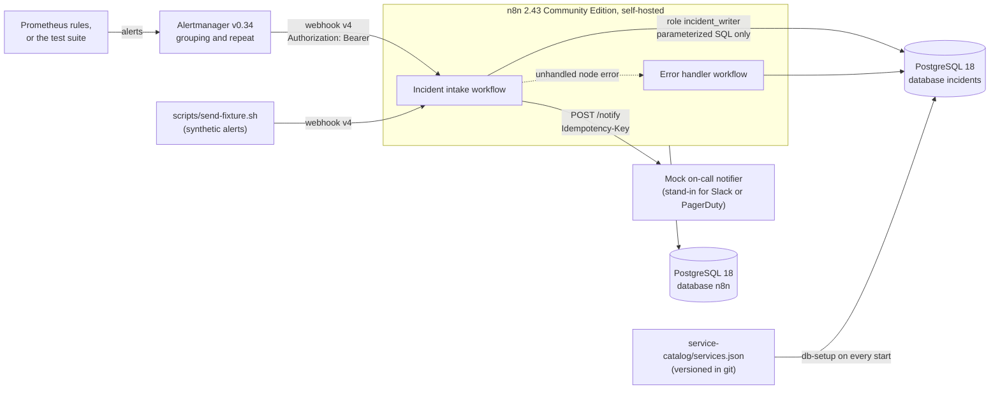
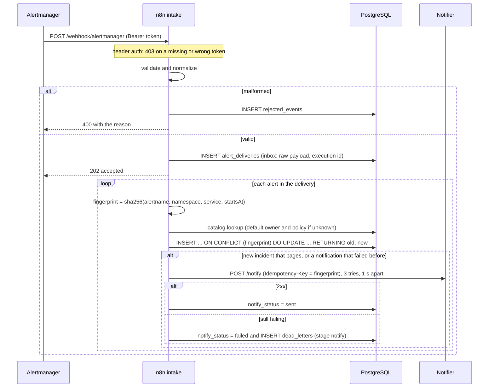
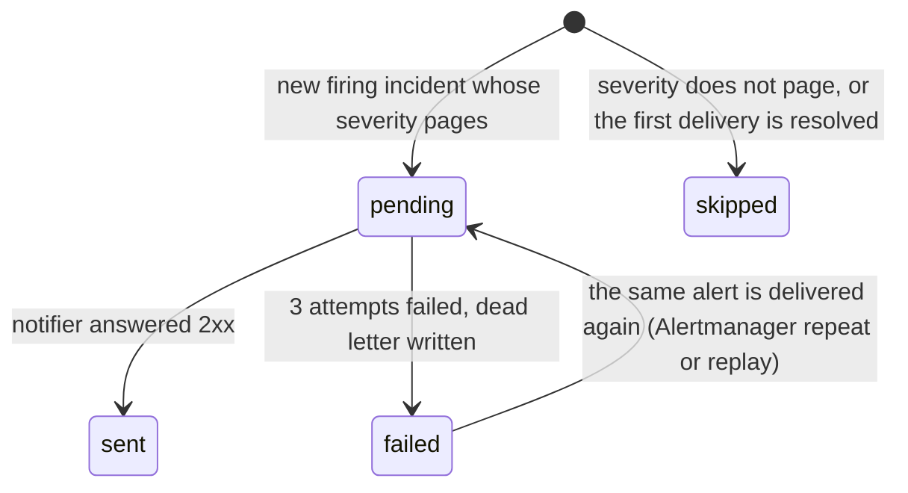

# Incident automation lab: architecture

**Scope:** the self-hosted n8n workflow in [`ops-automation/`](../ops-automation). **State:** CURRENT. Every element below is implemented and covered by `make test`, except the items under "Planned".

Alertmanager decides *when* to notify (grouping, waiting, repeat intervals). n8n decides *what an alert means for the team*: which incident it belongs to, who owns it, whether it pages, and what happens when paging fails.

## Containers

Legend: every box and solid arrow is implemented and tested. The dashed arrow is n8n's error-workflow trigger.

| Container | Technology | Responsibility |
|---|---|---|
| Alertmanager | `prom/alertmanager:v0.34.1` | Groups by `alertname`, `namespace`, `service`; sends the bearer token from a file |
| n8n | `n8nio/n8n:2.43.7` | Authenticates, validates, fingerprints, enriches and stores incidents; pages; records failures |
| PostgreSQL | `postgres:18.4` | `incidents` database (inbox, incidents, rejected events, dead letters, catalog) and n8n's own database |
| db-setup | same PostgreSQL image, one-shot | Idempotent roles, schema and catalog load on every start |
| n8n-import | same n8n image, one-shot | Builds credentials from `.env` inside the container, imports and publishes the workflows from git |
| Mock notifier | Node.js 24, no dependencies | Accepts or fails notifications on demand; deduplicates by `Idempotency-Key` |

## Critical flow

## Notification state

## Failure and recovery

| Failure | What happens | How it is recovered | Test |
|---|---|---|---|
| Missing or wrong token | n8n answers 403 before the workflow runs; nothing is stored | — | authentication |
| Malformed payload | 400 with the reason; stored in `rejected_events` (first 2,000 characters) | Fix the sender | validation |
| Notifier down briefly | Node-level retry: up to 3 tries, 1 s apart | Automatic | retry |
| Notifier down for longer | `notify_status = failed`, dead letter with the delivery id | `make replay`, or Alertmanager's next repeat of the still-firing alert | permanent failure, replay |
| Database lock held too long | `incident_writer` has `lock_timeout = 2s`; the upsert fails, the error workflow records a dead letter that points at the stored payload | `make replay` | workflow failure |
| n8n or PostgreSQL restart | State lives in PostgreSQL volumes | Automatic | restart |

## Decisions and trade-offs

1. **Deduplication belongs to the database, not to the workflow.** A lookup followed by an insert in n8n races when Alertmanager retries or two deliveries overlap. A unique fingerprint with `INSERT ... ON CONFLICT` serializes them on the row. Verified: 5 concurrent deliveries of the same alert produce one incident and one page.
2. **Incident identity is alert name + namespace + service + `startsAt`.** Two pods failing the same alert in one service are one incident. A new firing episode after resolution has a new `startsAt` and pages again. Rejected: Alertmanager's own fingerprint, which ignores the episode.
3. **Store first, then acknowledge.** The raw payload is written to `alert_deliveries` before the 202. Anything that fails after the acknowledgement can be replayed from there. Rejected: answering only after paging. Alertmanager would wait through notifier retries and might send the batch again.
4. **A failed page is retried by the next delivery, not by a loop.** `RETURNING old.notify_status` tells the workflow whether this delivery changed `failed` back to `pending`. The row lock means only one concurrent delivery wins. The first design used a CTE with `FOR UPDATE` on PostgreSQL 17: the CTE was evaluated after the update, the lock skipped the row, and replays never paged. The replay test caught it, which is why the lab runs PostgreSQL 18.
5. **The notifier receives an `Idempotency-Key`.** Delivery is at least once. A receiver that deduplicates by key (as the mock does) turns that into exactly one page.
6. **Least privilege:**
   - The workflow connects as `incident_writer`, which can read the catalog and insert or update incident data, nothing else.
   - The role has `lock_timeout = 2s` and `statement_timeout = 5s`.
   - Every value reaches SQL as a query parameter (`$1::text`).
7. **Secrets:**
   - `make env` generates `.env`, which git ignores.
   - n8n credentials are built inside the import container from environment variables and encrypted by n8n with `N8N_ENCRYPTION_KEY`.
   - The workflow JSON in git contains only credential ids and names.

## Patterns adapted (originality record)

| Pattern and source | Problem here | What is different in this lab | Simpler option rejected | Proof |
|---|---|---|---|---|
| Alertmanager grouping and webhook receiver ([configuration](https://prometheus.io/docs/alerting/latest/configuration/#webhook_config)) | Many alerts for one failure | Grouping stays in Alertmanager; n8n only owns incident state | Grouping in n8n, which would duplicate Alertmanager | Alertmanager path |
| Inbox, the receiving side of the transactional outbox ([AWS](https://docs.aws.amazon.com/prescriptive-guidance/latest/cloud-design-patterns/transactional-outbox.html)) | Work after the 202 can fail | The stored payload is the replay source; dead letters point at it | Hoping the sender re-sends | workflow failure, replay |
| Retry with backoff and idempotent operations ([AWS](https://docs.aws.amazon.com/prescriptive-guidance/latest/cloud-design-patterns/retry-backoff.html)) | Notifier outages | Bounded node-level retry, then a dead letter; an `Idempotency-Key` makes replays safe | Unbounded retry inside the workflow | retry, permanent failure, replay |
| PostgreSQL upsert with row locking ([INSERT ON CONFLICT](https://www.postgresql.org/docs/18/sql-insert.html)) | Concurrent duplicate deliveries | `RETURNING old/new` decides paging inside the same statement | Lookup, then insert | deduplication |

## Limitations

- **Local lab with a mock notifier.** No real Slack, PagerDuty or GitHub integration is wired, not even a sandbox one.
- **Retry policy:**
  - Fixed 1 s wait, not exponential.
  - n8n's node-level retry also retries 4xx answers that will never succeed.
- **A crash between the incident write and the page leaves `notify_status = pending`.** Nothing retries it automatically. The runbook has the query that finds it.
- **Notifications are at least once.** A receiver that does not deduplicate by key could get a second page when a failed notification is retried concurrently.
- **Not wired to the cluster.** The kind cluster's Prometheus does not send to this Alertmanager yet; the lab runs in Docker Compose next to it.
- **Single instance.** One n8n instance, no queue mode. Execution data is kept for 7 days.
- **Restart test scope.** It restarts the PostgreSQL and n8n containers with their volumes, not the host.

## Planned (not implemented)

- Route the kind cluster's Prometheus to this Alertmanager, so an outage drill opens a real incident end to end.
- A periodic sweep that re-pages incidents stuck in `pending`.
- An optional sandbox integration (a GitHub issue in a private test repository), credential-free in git.
