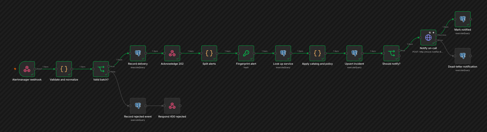

# Incident automation lab (n8n)

**Problem:** an alert fires, Alertmanager sends it again, and a pod restarts and fires it once more. Without care, on-call gets three pages, nobody knows who owns the service, and when the paging tool is down the alert is silently lost.

This lab puts a self-hosted n8n workflow between Alertmanager and on-call:
- It authenticates and validates every delivery.
- It stores the raw payload before acknowledging.
- It keeps one incident per firing episode.
- It enriches the incident with owner and runbook from a catalog in git.
- It pages through a retrying notifier, and records anything that still fails for a safe replay.



## Quick start

Requirements: Docker with Compose, Node.js 20 or newer (for the tests), `jq`, `curl` and `openssl`.

```bash
make up      # first run pulls images; then about 20 s until every health check passes
make test    # 15 integration tests against the running stack
make down
```

## What the tests prove

| Path | Result |
|---|---|
| Missing or wrong bearer token | 403, nothing stored |
| Malformed payloads (4 kinds) | 400 with the reason, recorded in `rejected_events` |
| One firing alert | One incident, owner and runbook from the catalog, one notification |
| 3 repeated plus 5 concurrent deliveries | Still one incident (9 occurrences) and one notification |
| Unknown service | Default owner `platform-oncall` and the unknown-service runbook |
| Warning for a service that pages only on critical | Stored, not paged |
| Notifier fails twice | Third attempt succeeds; one notification |
| Notifier keeps failing | Exactly 3 attempts, then a dead letter; no loop |
| Replay after recovery | One notification; a second replay does nothing |
| Database lock timeout after the 202 | Error workflow records a dead letter that points at the stored payload; the replay applies it |
| Alert posted to Alertmanager | Reaches n8n with the bearer token and creates the incident |
| Restart of PostgreSQL and n8n | Deduplication still holds; no second page |
| Prometheus metrics | Successful, failed and error-handler executions are counted |

Measured results and the n8n security audit: [VERIFICATION](../docs/INCIDENT_AUTOMATION_VERIFICATION.md).
Design and trade-offs: [ARCHITECTURE](../docs/INCIDENT_AUTOMATION_ARCHITECTURE.md).
Operating it: [RUNBOOK](../docs/INCIDENT_AUTOMATION_RUNBOOK.md).

## Layout

| Path | Contents |
|---|---|
| `workflows/` | `incident-intake.json` and `incident-error-handler.json`, credential-free n8n exports |
| `db/` | Idempotent roles, schema and catalog load |
| `service-catalog/` | Synthetic services, owners, paging policy and runbooks |
| `fixtures/` | Valid, batch, resolved and malformed Alertmanager payloads |
| `mock-notifier/` | Stand-in for the paging tool, with switchable failure modes |
| `tests/` | Integration tests (`node:test`, no dependencies) |
| `scripts/` | `send-fixture.sh` and `replay-dead-letters.sh` |

Everything here is local and synthetic. The notifier is a mock, and no alert leaves the machine.
